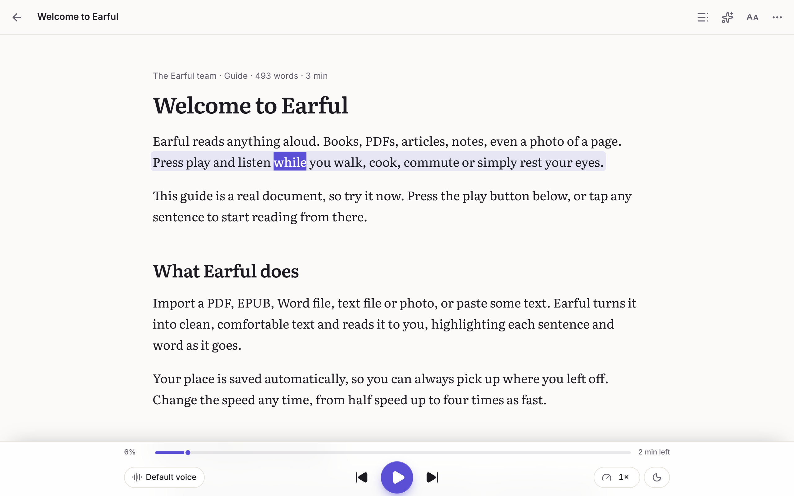
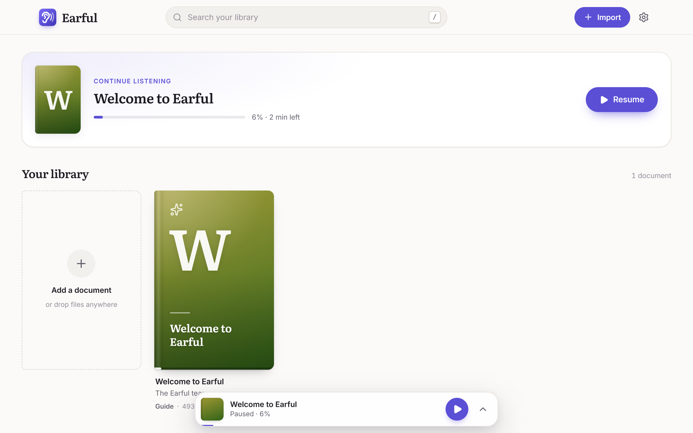
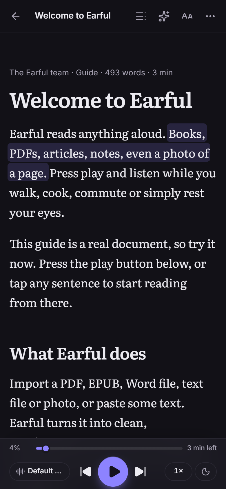

<div align="center">


# Earful

**Listen to anything. Free, private, and it works offline.**

Earful reads your PDFs, books, Word files, articles and photos of text out loud, highlighting each word as it goes.
It's a free, open-source alternative to paid text-to-speech readers like Speechify: no account, no trial, no subscription.

**[Open Earful →](https://bassambeelal.github.io/earful/)**

</div>



<p align="center">
  
  
</p>

## Why

The popular reading apps lock the basics behind a subscription of around $139 a year. Free users get robotic voices, a 1.5× speed cap, a handful of files and no scanning. Earful gives you all of it for free, and keeps your documents on your own device.

| | Paid reading apps (free tier) | Earful |
|---|---|---|
| Natural-sounding voices | Premium only | **Free** (on-device neural voices) |
| Listening speed | Capped at 1.5× | **0.5× – 4×** |
| Library size | A few files | **Unlimited** |
| Scanned PDFs & photos (text recognition) | Premium only | **Free, on-device** |
| Offline listening | Premium only | **Free** (installable app) |
| Download as MP3 | Premium only | **Free** |
| AI summaries, quizzes, chat | Premium only | **Free with your own key** |
| Account required | Yes | **No** |
| Your documents | Uploaded to their servers | **Never leave your device** |

## Features

- **Import almost anything**: PDF (including scanned PDFs), EPUB, Word (.docx), text, Markdown, web pages you paste, and photos of pages (on-device text recognition).
- **Word-by-word highlighting** with auto-scroll. Click any sentence to jump there.
- **Three kinds of voices**
  - **Browser voices**: instant and free. On Microsoft Edge these include the very natural "Online (Natural)" voices at no cost.
  - **Natural voices (offline)**: the Kokoro neural voice model runs entirely in your browser on your graphics chip (WebGPU), downloaded once (about 330 MB). There's no key, no server, and after the first download it works with no internet at all. Browsers without WebGPU get a smaller 92 MB version that's great for saving audio files but may pause while listening live.
  - **Premium voices with your own key**: OpenAI, Google Gemini, ElevenLabs, Groq, or any OpenAI-compatible server (for example Kokoro-FastAPI). You pay the provider directly, at cost, instead of a subscription. Audio is cached, so you never pay twice for the same sentence.
- **Smart skipping** of citations like [12] and (Smith, 2020), URLs, running headers, footers and page numbers.
- **Speed from 0.5× to 4×** with pitch preserved, a sleep timer, lock-screen and headphone controls.
- **Export to MP3 or WAV**, whole documents or a single chapter.
- **AI study tools with your own key**: summaries, chat with the document, quizzes, "explain this", rewrite at a simpler reading level, and translate-then-listen. Works with OpenAI, Anthropic Claude, Google Gemini, OpenRouter, Groq, local models (Ollama, LM Studio), or Chrome's built-in AI with no key.
- **Comfortable reading**: light, dark and sepia themes, OpenDyslexic and Atkinson Hyperlegible fonts, adjustable size and spacing, and a focus mode.
- **Installable app** for Windows, macOS, Linux, ChromeOS, Android and iOS, straight from the browser.

## Privacy

- Your documents are stored in your browser's local storage (IndexedDB). They are never uploaded anywhere.
- Your API keys are stored only in this browser. When you use a premium voice or an AI tool, the request goes **directly from your browser to the provider you chose**. There's no Earful server in between.
- No analytics, no tracking, no account.

## Use it

Open **https://bassambeelal.github.io/earful/** in any modern browser. To install it as an app, use the **Install** button in Earful, or your browser's "Install app" / "Add to Home Screen" menu.

### Getting API keys (optional)

| Provider | Used for | Get a key |
|---|---|---|
| OpenAI | Voices + AI tools | https://platform.openai.com/api-keys |
| Google Gemini | Voices + AI tools (generous free tier) | https://aistudio.google.com/apikey |
| ElevenLabs | Voices (exact word timing) | https://elevenlabs.io/app/settings/api-keys |
| Groq | Voices + fast AI tools | https://console.groq.com/keys |
| Anthropic | AI tools | https://console.anthropic.com/settings/keys |
| OpenRouter | AI tools (hundreds of models) | https://openrouter.ai/keys |

Paste the key in **Settings**. You can remove it at any time.

## Run it locally

You need Node.js 20 or newer.

```bash
git clone https://github.com/bassambeelal/earful.git
cd earful
npm install
npm run dev
```

Then open http://localhost:5173.

To build a static site you can host anywhere:

```bash
npm run build
```

The `dist/` folder is the whole app. Each [release](https://github.com/bassambeelal/earful/releases) also includes a ready-made `earful-web-*.zip` you can unzip onto any static host.

## How it works

Earful is a static web app with no backend.

- **Vite + React + TypeScript**, installable as a PWA (offline via a service worker).
- **pdf.js** for PDFs, **tesseract.js** for OCR, **mammoth** for Word files, **JSZip** for EPUB, and **Readability** for pasted web pages.
- **kokoro-js** (Kokoro-82M on ONNX Runtime Web, WebGPU or WASM) in a Web Worker for the offline neural voices.
- The **Web Speech API** for browser voices, and direct `fetch` calls to each provider for premium voices and AI.
- **IndexedDB** for your library and the audio cache.

## License

[GPL-3.0](LICENSE). Earful is free software: you can use, study, share and improve it.

Kokoro voice model © hexgrad (Apache-2.0). kokoro-js by Xenova and hexgrad (Apache-2.0). The phonemizer ships espeak-ng (GPL-3.0).
